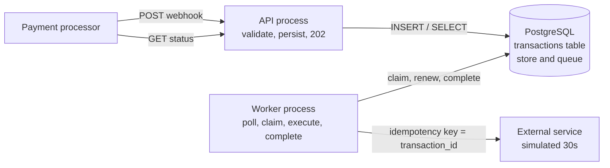
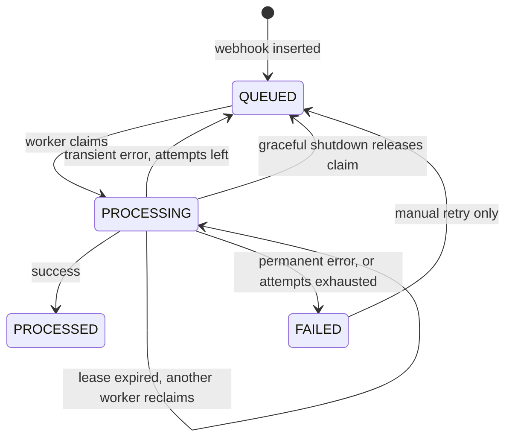
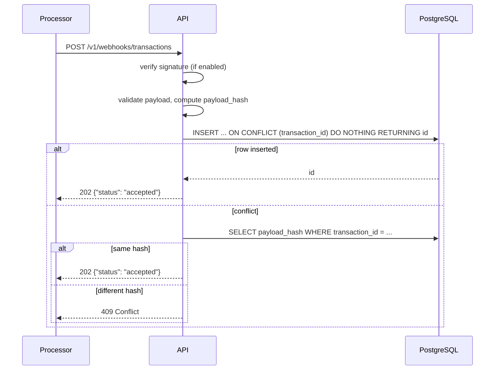

# Technical Design: Transaction Webhook Service

Status: proposed, not yet implemented. This document replaces the in-process scheduler described in `README.md`. The stack stays the same: FastAPI, PostgreSQL, SQLAlchemy, psycopg.

## 1. Goals and non-goals

Goals, from the assessment:

- `POST /v1/webhooks/transactions` returns `202` within 500 ms.
- Each accepted transaction is processed once in the background, with a simulated 30-second external call.
- `GET /v1/transactions/{transaction_id}` returns the stored state and timestamps.
- `GET /` returns `{"status": "HEALTHY", "current_time": ...}`.
- No accepted transaction is lost when the API or worker crashes or restarts.
- Publicly reachable cloud deployment.

Non-goals:

- No message broker (Redis, Celery, Kafka). PostgreSQL is the store and the queue.
- No exactly-once guarantee for external side effects. See section 7.
- No real payment-provider integration. The external call is simulated.

## 2. Guarantees

| Property | Guarantee | Mechanism |
| --- | --- | --- |
| Durability of acceptance | A `202` is returned only after the row is committed | Insert and commit inside the request, before responding |
| One record per transaction | Exactly one row per `transaction_id` | `UNIQUE (transaction_id)` and `INSERT ... ON CONFLICT DO NOTHING` |
| No concurrent execution | At most one worker holds a valid claim at a time | `FOR UPDATE SKIP LOCKED` claim and a lease |
| No stale overwrite | A worker whose lease was taken over cannot change the row | Every write after a claim is conditional on `claim_token` |
| Eventual processing | Every accepted row reaches `PROCESSED` or `FAILED` while a worker is running | Polling, lease expiry, bounded retries |
| Execution semantics | At-least-once execution, idempotent by `transaction_id` | Stable idempotency key passed to the external call |

## 3. Components



The API and the worker never talk to each other. The only coordination point is the database. Either process can restart without the other.

| Process | Command | Scales |
| --- | --- | --- |
| API | `uvicorn app.main:app` | Horizontally; stateless |
| Worker | `python -m app.worker` | Horizontally; claims are exclusive |

## 4. State machine

Internal states:

| State | Meaning |
| --- | --- |
| `QUEUED` | Persisted and eligible once `next_attempt_at <= now()` |
| `PROCESSING` | Claimed by a worker that holds an unexpired lease |
| `PROCESSED` | Completed successfully. Terminal |
| `FAILED` | Permanent error or attempts exhausted. Terminal for automatic processing |



Allowed transitions are enforced by the `WHERE` clause of each update, not by application code reading the row first.

### Public status mapping

The assessment's examples only show `PROCESSING` and `PROCESSED`. To keep the evaluator's contract, the status API reports:

| Internal | `status` in the API |
| --- | --- |
| `QUEUED` | `PROCESSING` |
| `PROCESSING` | `PROCESSING` |
| `PROCESSED` | `PROCESSED` |
| `FAILED` | `FAILED` |

The internal state is exposed additionally as `processing_state` so the distinction stays observable. See open decision D1.

## 5. Data model

```sql
CREATE TABLE transactions (
    id                  BIGSERIAL PRIMARY KEY,
    transaction_id      VARCHAR(128) NOT NULL UNIQUE,

    source_account      VARCHAR(128) NOT NULL,
    destination_account VARCHAR(128) NOT NULL,
    amount              NUMERIC(18, 2) NOT NULL CHECK (amount > 0),
    currency            CHAR(3) NOT NULL,
    payload_hash        CHAR(64) NOT NULL,

    status              VARCHAR(16) NOT NULL DEFAULT 'QUEUED'
                        CHECK (status IN ('QUEUED', 'PROCESSING', 'PROCESSED', 'FAILED')),

    created_at          TIMESTAMPTZ NOT NULL DEFAULT now(),
    updated_at          TIMESTAMPTZ NOT NULL DEFAULT now(),
    processed_at        TIMESTAMPTZ,

    attempt_count       INTEGER NOT NULL DEFAULT 0,
    max_attempts        INTEGER NOT NULL DEFAULT 5,
    next_attempt_at     TIMESTAMPTZ NOT NULL DEFAULT now(),
    last_error          TEXT,

    worker_id           VARCHAR(128),
    claim_token         BIGINT NOT NULL DEFAULT 0,
    claimed_at          TIMESTAMPTZ,
    lease_expires_at    TIMESTAMPTZ,

    CHECK ((status = 'PROCESSED') = (processed_at IS NOT NULL)),
    CHECK ((status = 'PROCESSING') = (lease_expires_at IS NOT NULL))
);

CREATE INDEX transactions_ready_idx
    ON transactions (next_attempt_at, id)
    WHERE status = 'QUEUED';

CREATE INDEX transactions_lease_idx
    ON transactions (lease_expires_at)
    WHERE status = 'PROCESSING';
```

Notes:

- All timestamps come from the database clock (`now()`), never from the API or worker host, so clock drift between processes cannot reorder events or expire leases early.
- `claim_token` is a fencing token. It increments on every claim, so a worker that lost its lease holds a stale token and every write it attempts matches zero rows.
- `attempt_count` increments at claim time, not at failure time. A worker that crashes mid-call still consumes an attempt, which bounds crash loops.
- Monetary values are `Decimal` in Python and `NUMERIC(18, 2)` in PostgreSQL.
- Schema creation: the current table is created by `Base.metadata.create_all`, which does not alter existing tables. The schema change is incompatible, so local and OCI databases must be recreated (`docker compose down -v`). Alembic is a later addition; see section 12.

### Payload hash

`payload_hash` is SHA-256 over a canonical form of the validated payload, so formatting differences in the request body do not count as conflicts:

```text
transaction_id|source_account|destination_account|amount|currency
```

`amount` is rendered as a normalized decimal with two places (`1500.00`). Text fields have already been stripped and `currency` upper-cased by `WebhookRequest`.

## 6. Ingestion flow



Rules:

- The handler does one insert and, only on conflict, one indexed select. No scheduling, no sleeping, no external calls.
- A database error returns `503`. The processor will retry, and the retry is safe because of the unique key.
- The conflict check is race-free: whichever request wins the insert defines the stored payload, and losers compare against a committed row.
- The handler signals no worker. A new row is discovered by polling, at most `POLL_INTERVAL_SECONDS` later.

## 7. Worker algorithm

### 7.1 Main loop

```text
worker_id = f"{hostname}:{pid}:{random}"
slots     = Semaphore(MAX_CONCURRENT_JOBS)

loop until shutdown:
    free = slots.available()
    if free > 0:
        jobs = claim(limit=free)          # short DB transaction, committed
        for job in jobs:
            start task: run(job)          # holds one slot until done
    if no jobs claimed:
        sleep(POLL_INTERVAL_SECONDS)
```

The worker claims only as many jobs as it has free slots, so it never holds leases on work it cannot start.

### 7.2 Claim

One statement in one short transaction. It picks up new work, scheduled retries, and expired leases from crashed workers:

```sql
WITH candidates AS (
    SELECT id
    FROM transactions
    WHERE (status = 'QUEUED' AND next_attempt_at <= now())
       OR (status = 'PROCESSING' AND lease_expires_at < now())
    ORDER BY next_attempt_at, id
    LIMIT :limit
    FOR UPDATE SKIP LOCKED
)
UPDATE transactions t
SET status           = 'PROCESSING',
    worker_id        = :worker_id,
    claim_token      = t.claim_token + 1,
    claimed_at       = now(),
    lease_expires_at = now() + make_interval(secs => :lease_seconds),
    attempt_count    = t.attempt_count + 1,
    updated_at       = now()
FROM candidates c
WHERE t.id = c.id
RETURNING t.id, t.transaction_id, t.claim_token, t.attempt_count, t.max_attempts;
```

`SKIP LOCKED` makes concurrent workers skip rows another worker is claiming. The lease makes a crashed worker's rows claimable again. Neither alone is sufficient.

Before the claim, a separate statement moves expired leases whose attempts are already exhausted to `FAILED` with `last_error = 'lease expired; attempts exhausted'`, so a job that kills its worker every time cannot loop forever.

### 7.3 Execute

```text
run(job):
    heartbeat = start task: every LEASE_RENEW_SECONDS
                    UPDATE ... SET lease_expires_at = now() + lease
                    WHERE id = :id AND claim_token = :token AND status = 'PROCESSING'
                    if 0 rows: lease lost -> cancel the call

    try:
        result = external.process(job, idempotency_key=job.transaction_id)
        complete(job)
    except TransientError as e:
        retry_or_fail(job, e)
    except PermanentError as e:
        fail(job, e)
    finally:
        cancel heartbeat; release slot
```

No database transaction or row lock is held during the 30-second call. Each claim, renewal, and completion is its own short transaction.

The simulated external service sleeps `PROCESSING_DELAY_SECONDS` asynchronously. For tests it can be configured to fail a given number of times with a transient or permanent error.

### 7.4 Complete, retry, fail

All three are fenced by the claim token:

```sql
-- success
UPDATE transactions
SET status = 'PROCESSED', processed_at = now(), updated_at = now(),
    worker_id = NULL, claimed_at = NULL, lease_expires_at = NULL, last_error = NULL
WHERE id = :id AND claim_token = :token AND status = 'PROCESSING';

-- transient error with attempts left
UPDATE transactions
SET status = 'QUEUED',
    next_attempt_at = now() + make_interval(secs => :backoff),
    last_error = :error, updated_at = now(),
    worker_id = NULL, claimed_at = NULL, lease_expires_at = NULL
WHERE id = :id AND claim_token = :token AND status = 'PROCESSING';

-- permanent error, or attempts exhausted
UPDATE transactions
SET status = 'FAILED', last_error = :error, updated_at = now(),
    worker_id = NULL, claimed_at = NULL, lease_expires_at = NULL
WHERE id = :id AND claim_token = :token AND status = 'PROCESSING';
```

If an update matches zero rows, the worker lost ownership. It logs and does nothing further.

Backoff: `min(RETRY_BASE_SECONDS * 2 ** (attempt_count - 1), RETRY_MAX_SECONDS)` with up to 20% random jitter. Defaults give 1, 2, 4, 8 seconds between five attempts.

Error classes:

| Class | Examples | Action |
| --- | --- | --- |
| Transient | timeout, connection error, external 5xx | Retry with backoff |
| Permanent | external 4xx, business rejection | `FAILED` immediately |
| Worker crash | process killed, host lost | Lease expires, row is reclaimed |
| Database error during completion | connection lost | Lease expires, row is reclaimed; the idempotency key makes the repeat call safe |

### 7.5 Graceful shutdown

On `SIGTERM` or `SIGINT`:

1. Stop claiming.
2. Wait up to `SHUTDOWN_GRACE_SECONDS` for in-flight jobs.
3. Cancel the rest and release them: `status = 'QUEUED', next_attempt_at = now()`, decrement `attempt_count`, fenced by claim token.

A release is a courtesy that makes the job available without waiting for lease expiry. Correctness does not depend on it, because `SIGKILL` skips it.

### 7.6 Lease sizing

| Setting | Default | Constraint |
| --- | --- | --- |
| `PROCESSING_DELAY_SECONDS` | 30 | Assessment value |
| `LEASE_SECONDS` | 60 | Greater than renew interval plus a database round trip, with margin |
| `LEASE_RENEW_SECONDS` | 15 | Under a third of `LEASE_SECONDS` |
| `POLL_INTERVAL_SECONDS` | 0.5 | Adds at most this much to completion time |
| `MAX_CONCURRENT_JOBS` | 50 | Async sleep is cheap; bounded by DB pool size |

Renewal is what makes the lease safe for calls longer than the lease. Without it, a slow but healthy call would be reclaimed and executed twice. Worst-case recovery after a crash is `LEASE_SECONDS` plus one poll interval.

### 7.7 Execution semantics

This design gives at-least-once execution. The window for a repeat is: the external call succeeds, then the worker dies or loses the database before the completion update commits. The lease expires and another worker calls the external service again.

That repeat is made harmless by passing `transaction_id` as the idempotency key, so a real provider would return the original result instead of executing twice. The simulated service records keys it has completed and returns the same result for a repeat, which lets tests demonstrate this. Without an idempotent provider, exactly-once execution of an external side effect is not achievable by database state alone.

### 7.8 Throughput

With `MAX_CONCURRENT_JOBS = C` per worker and `W` workers, a burst of `N` transactions finishes in about `ceil(N / (C * W)) * 30` seconds. With the defaults, 100 simultaneous transactions on one worker finish in about 60 seconds; with `MAX_CONCURRENT_JOBS = 100`, about 30 seconds. The limit should not exceed what the database connection pool supports, since every renewal and completion needs a connection briefly.

## 8. API contract

### `POST /v1/webhooks/transactions`

Body: as in the assessment. `amount` is decimal with at most two places; `currency` is a three-letter code.

| Case | Response |
| --- | --- |
| New transaction | `202 {"status": "accepted"}` |
| Same `transaction_id`, same payload | `202 {"status": "accepted"}` |
| Same `transaction_id`, different payload | `409 {"detail": "transaction_id already used with a different payload"}` |
| Invalid body | `422` |
| Signature missing or invalid (when enabled) | `401` |
| Database unavailable | `503` |

### `GET /v1/transactions/{transaction_id}`

Returns a one-element array, matching the assessment example:

```json
[
  {
    "transaction_id": "txn_abc123def456",
    "source_account": "acc_user_789",
    "destination_account": "acc_merchant_456",
    "amount": 1500,
    "currency": "INR",
    "status": "PROCESSED",
    "processing_state": "PROCESSED",
    "created_at": "2024-01-15T10:30:00Z",
    "processed_at": "2024-01-15T10:30:30Z",
    "attempts": 1,
    "last_error": null
  }
]
```

| Case | Response |
| --- | --- |
| Found | `200` |
| Not found | `404` |
| Database unavailable | `503` |

### `GET /`

Liveness. Unchanged: `{"status": "HEALTHY", "current_time": "<UTC ISO 8601 Z>"}`. Does not touch the database, so a database outage does not cause the platform to restart a healthy API.

### `GET /health/ready`

Readiness. Runs `SELECT 1` with a one-second timeout. Returns `200 {"status": "READY"}` or `503 {"status": "NOT_READY"}`. Also reports `queued`, `processing`, and `oldest_queued_age_seconds` so a stalled worker is visible: queued work that keeps aging means no worker is running.

### Webhook signature (optional)

Enabled only when `WEBHOOK_SECRET` is set. The API computes HMAC-SHA256 over the raw request body and compares it in constant time with the `X-Signature: sha256=<hex>` header. This is a generic scheme, not compatible with any specific provider. A real integration would implement that provider's documented verification instead. Disabled by default because the assessment defines no signing protocol.

## 9. Failure scenarios

| # | Failure | Outcome |
| --- | --- | --- |
| F1 | API crashes before commit | No `202` was sent; processor retries |
| F2 | API crashes after commit, before responding | Row is `QUEUED`; processor retries and gets `202` for the duplicate; worker processes once |
| F3 | API crashes after responding | Row is `QUEUED`; worker discovers it by polling |
| F4 | Worker crashes during the call | Lease expires; another or restarted worker reclaims it; attempt counted |
| F5 | Worker crashes after the external call, before completion | Reclaimed; external call repeats with the same idempotency key |
| F6 | Worker is paused longer than its lease, then resumes | Its renewal and completion match zero rows; it stops |
| F7 | Two workers poll at the same moment | `SKIP LOCKED` gives each row to one worker |
| F8 | Concurrent identical webhooks | One insert wins; all get `202` |
| F9 | Database down | Webhook returns `503`; worker backs off its poll loop and keeps retrying |
| F10 | Transient external failures | Retried with backoff up to `max_attempts`, then `FAILED` |
| F11 | Job crashes its worker every time | Attempts exhausted on lease expiry, moved to `FAILED` |
| F12 | No worker is running | Rows stay `QUEUED`; nothing lost; visible in `/health/ready` |

## 10. Configuration

| Variable | Default | Used by |
| --- | --- | --- |
| `DATABASE_URL` | local Postgres | both |
| `DB_POOL_SIZE` | 10 | both |
| `DB_STATEMENT_TIMEOUT_MS` | 2000 | both |
| `WEBHOOK_SECRET` | unset (verification off) | API |
| `PROCESSING_DELAY_SECONDS` | 30 | worker |
| `POLL_INTERVAL_SECONDS` | 0.5 | worker |
| `MAX_CONCURRENT_JOBS` | 50 | worker |
| `LEASE_SECONDS` | 60 | worker |
| `LEASE_RENEW_SECONDS` | 15 | worker |
| `MAX_ATTEMPTS` | 5 | API (row default) |
| `RETRY_BASE_SECONDS` | 1 | worker |
| `RETRY_MAX_SECONDS` | 60 | worker |
| `SHUTDOWN_GRACE_SECONDS` | 10 | worker |

`RECOVERY_INTERVAL_SECONDS` is removed; polling replaces it.

## 11. Code layout

A moderate split of the current flat package. The full layered tree (repositories, services, and so on) is more structure than a service this size needs.

```text
app/
  config.py        settings from environment
  db.py            engine, session, schema creation
  models.py        Transaction ORM model, status constants
  schemas.py       request/response models, payload hash
  repository.py    insert_or_get, get, claim, renew, complete, retry, fail, release, stats
  security.py      optional HMAC verification
  main.py          FastAPI app and routes
  external.py      simulated external service with idempotency keys and fault injection
  worker.py        poll loop, concurrency, heartbeat, shutdown; `python -m app.worker`
tests/
  conftest.py
  test_api.py          contract, status codes, 409, 422, 404, timing
  test_idempotency.py  concurrent identical inserts, conflicting payloads
  test_worker.py       success, retry, fail, fencing, release
  test_concurrency.py  multiple workers, no double claim
  test_recovery.py     killed worker, lease expiry, API restart
scripts/
  load_test.py         concurrent webhook burst with p50/p95/p99
```

All SQL lives in `repository.py`. The worker and the routes call repository functions and contain no SQL.

Removed: the in-process `schedule`, `_scheduled`, and `recover_loop` in `app/worker.py`, and the recovery task in the API lifespan.

## 12. Deployment

`docker-compose.yml` and `docker-compose.oci.yml` gain a `worker` service from the same image:

```yaml
  worker:
    build: .
    command: ["python", "-m", "app.worker"]
    environment:
      DATABASE_URL: ...
      PROCESSING_DELAY_SECONDS: "30"
    depends_on:
      db:
        condition: service_healthy
    restart: unless-stopped
    stop_grace_period: 15s
```

- The OCI single-VM deployment stays. The README's "keep a single API container" restriction no longer applies; the API and worker can each be scaled with `--scale`.
- The worker must run on a platform that keeps long-lived processes. Request-scoped serverless runtimes are unsuitable for it.
- Schema creation happens on API startup and worker startup with `CREATE TABLE IF NOT EXISTS` and `CREATE INDEX IF NOT EXISTS`. Alembic is added only if the schema needs to evolve after deployment.

## 13. Test plan

Unit and integration tests run against real PostgreSQL with `PROCESSING_DELAY_SECONDS` around 0.2 and short leases.

| ID | Scenario | Expected |
| --- | --- | --- |
| T1 | One valid webhook | `202` in under 500 ms |
| T2 | Status immediately after | `status = PROCESSING`, `processed_at = null` |
| T3 | Status after the delay | `PROCESSED`, `processed_at - created_at` close to the delay |
| T4 | Same webhook sent repeatedly | All `202`, one row, one external call |
| T5 | 100 identical webhooks concurrently | All `202`, one row, one external call |
| T6 | 100 distinct webhooks concurrently | All `202`, all rows, all processed |
| T7 | Two or more workers, many jobs | Each job executed once, no overlapping claims |
| T8 | Worker killed mid-call | Reclaimed after lease expiry and processed |
| T9 | API restarted after accepting | Job still processed |
| T10 | External fails twice, then succeeds | `PROCESSED`, `attempts = 3` |
| T11 | External always fails transiently | `FAILED` after `max_attempts` |
| T12 | Permanent external error | `FAILED` after one attempt |
| T13 | Same ID, different payload | `409`, stored row unchanged |
| T14 | Stale worker completes after takeover | Zero rows updated, new owner's result stands |
| T15 | Database stopped | Webhook `503`, `/health/ready` `503`, `/` still `200` |
| T16 | Malformed body | `422` |
| T17 | Unknown ID | `404` |
| T18 | Graceful worker shutdown | In-flight jobs released and picked up by another worker |

Latency: `scripts/load_test.py` sends a configurable burst against a base URL and reports mean, p50, p95, p99, maximum, and error rate. Target: p95 under 200 ms from the same region, which leaves room for network latency to an external tester.

The existing tests change in two places: duplicate-with-different-payload now expects `409` instead of `202`, and tests start a worker explicitly because the API no longer processes anything itself.

## 14. Implementation phases

1. Schema, models, repository with insert-or-get, payload hash, `409`, status mapping, readiness endpoint. Existing API tests pass with the updated expectations.
2. Worker process: poll, claim, concurrency limit, simulated external service, completion. Remove the in-process scheduler. T1 to T7.
3. Reliability: lease renewal, fencing, retries and backoff, exhaustion, graceful release. T8 to T14, T18.
4. Optional HMAC, compose `worker` service, load-test script, README rewrite, OCI redeploy with the database recreated. T15 and the latency run.

## 15. Open decisions

| ID | Decision | Proposed default | Alternative |
| --- | --- | --- | --- |
| D1 | Status value while queued | Report `PROCESSING`, expose `processing_state` | Report `QUEUED` directly, which may not match the evaluator's expectations |
| D2 | Conflicting duplicate payload | `409` | `202` and keep the first payload, as the current README does |
| D3 | Status response shape | One-element array, as in the assessment | Single object |
| D4 | Webhook signature | Optional, off by default | Required |
| D5 | Migrations | `IF NOT EXISTS` DDL at startup | Alembic from the start |

## 16. When to move off PostgreSQL as a queue

This design fits while the queue lives comfortably in one table: thousands of jobs per minute, one consumer type, short backlogs. A broker becomes worth its operational cost when there are several independent consumers for the same event, fan-out or routing needs, sustained throughput where polling and row churn dominate database load, or backlogs large enough to hurt the primary database. At that point, the transactional outbox pattern keeps the guarantee that acceptance and enqueue commit together.
